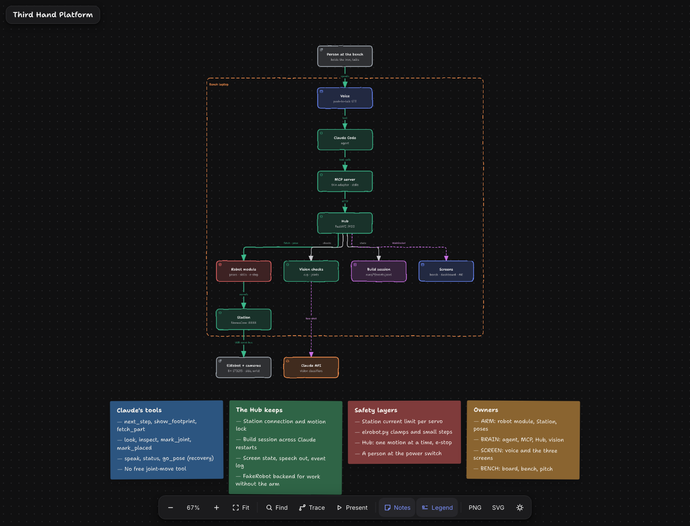
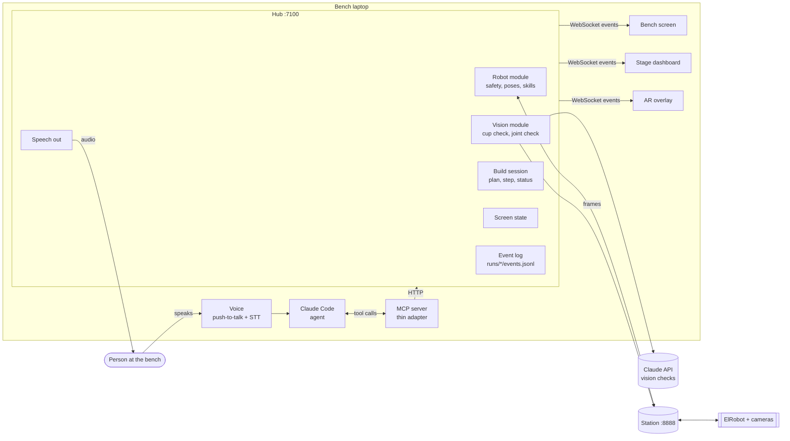
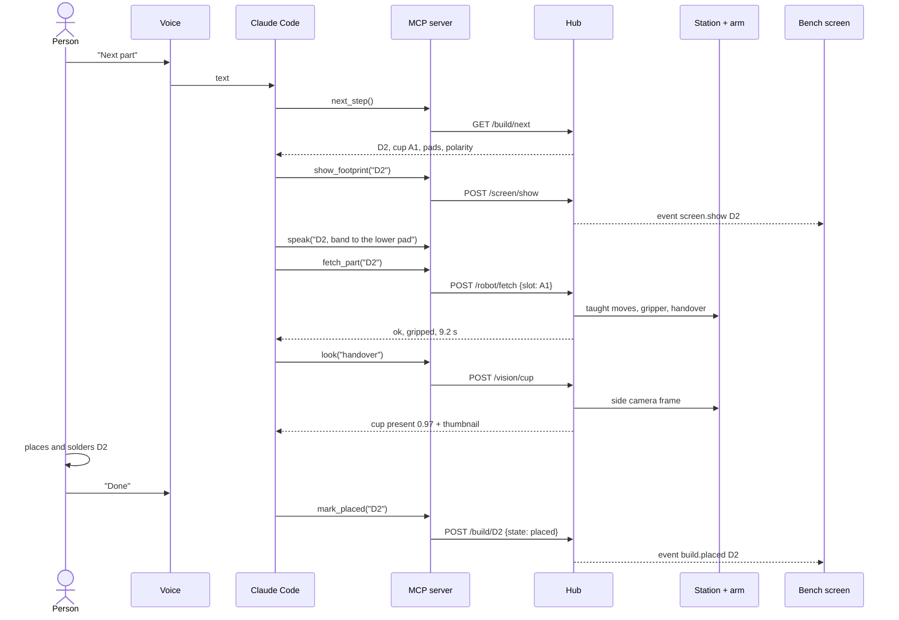
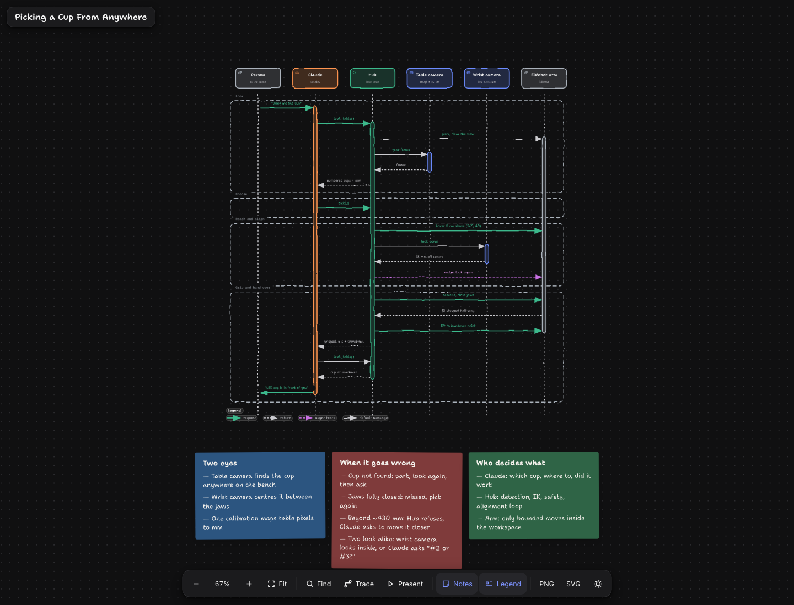

# 09 · Architecture (proposal)

**Status: proposal for the Sat 12:00 checkpoint.** Agree on it as a team, then treat the interfaces below as contracts.

> **Updated by [doc 10](10-plan-resistor-picker.md):** the Hub, safety layers and process layout below still hold. The demo is now the resistor picker, so the MCP tools become `scan_rack`, `pick`, `look`, `show_step`, `speak` and `status`, and `pick` runs a fine-tuned SmolVLA grasp with a scripted fallback.

## What has to be true

1. **It works on stage, every time.** A crashed agent session, a frozen camera or a restarted script must not lose the robot or the build's progress.
2. **Four people build in parallel from hour one.** Everything talks through a few small interfaces, and a fake robot stands in for the real one.
3. **Claude is visibly in charge.** The NormaCore track asks for Claude controlling the robot through its cameras, so the judges should see Claude's tool calls and what it saw.
4. **Hardware safety lives in code, not in prompts.** The model can only ask for taught, bounded motions.
5. **One laptop on the bench.** Station may also run on another machine on the same network.

## The pieces

| Process | What it does | Tech | Port | Owner |
|---|---|---|---|---|
| **Station** | Owns the servos and cameras, records everything | NormaCore binary | 8888 API, 8889 web | ARM |
| **Hub** | The single source of truth: robot control with safety, camera frames, vision checks, the build session, screen state, speech, event log | Python, FastAPI, asyncio | 7100 | BRAIN (robot module: ARM) |
| **Claude Code + MCP server** | The agent. The MCP server is a thin adapter that turns tool calls into Hub requests | Claude Code, MCP Python SDK | stdio | BRAIN |
| **Voice** | Push-to-talk, speech to text into Claude Code; speech out through the Hub | macOS dictation first, local Whisper later | none | SCREEN |
| **Bench screen** | The board with the next footprint lit up | Browser, served by the Hub | 7100/screen | SCREEN |
| **Stage dashboard** | Live cameras, Claude's tool timeline, build status, joint health | Browser, served by the Hub | 7100/dashboard | SCREEN |
| **AR overlay** | The highlight drawn on the live camera image | Browser canvas + homography | 7100/ar | SCREEN |

Why a separate Hub instead of putting everything in the MCP server: the MCP server restarts with every Claude session and does not hot-reload. The Hub keeps the Station connection, the motion lock, the e-stop and the build progress alive across restarts, and every screen reads the same state from it.

## How they connect



Interactive version with pan, zoom, path tracing and three guided views: [diagrams/architecture.html](diagrams/architecture.html) (download and open in a browser). Its source is [diagrams/architecture.json](diagrams/architecture.json).

The same wiring with every Hub module spelled out:



## One part, step by step



If `look` says the cup is missing, Claude says so, calls `fetch_part` again with `speed="slow"`, and looks again. After the last part, `inspect` moves the wrist camera, the Hub classifies each joint, and `mark_joint` circles any bad pad on the bench screen.

### Picking a cup from anywhere

When a cup is not where it was, nothing replays a recorded motion. The table camera finds every cup and the Hub numbers them, Claude chooses one by number, IK takes the gripper above it, and the wrist camera closes the last centimetres before the jaws close.



Interactive version with the three guided views: [diagrams/pick-process.html](diagrams/pick-process.html) (download and open in a browser). Source: [diagrams/pick-process.json](diagrams/pick-process.json).

## Hub API (contract)

All responses are JSON: `{"ok": true, ...}` or `{"ok": false, "code": "...", "message": "...", "hint": "..."}`. Errors are for Claude to read, so the `hint` says what to do next.

| Method | Path | Does |
|---|---|---|
| GET | `/robot/state` | Joints, busy flag, faults, backend (`station` or `fake`) |
| POST | `/robot/fetch` `{slot, speed}` | Whole fetch skill; rejects while another motion runs |
| POST | `/robot/pose` `{name}` | Go to a taught pose (`home`, `park`, `inspect_power`, ...) |
| POST | `/robot/gripper` `{norm}` | Jaws |
| POST | `/robot/estop` | Hold position and drop all queued motions. Also on a keyboard hotkey and the dashboard |
| GET | `/camera/{side,wrist}.jpg` | Latest frame; `?px=640` |
| GET | `/camera/{side,wrist}/mjpeg` | Live stream for the dashboard and AR overlay |
| POST | `/vision/cup` `{slot}` | Is the cup in the handover zone; returns verdict, confidence, thumbnail |
| POST | `/vision/joints` `{area or ref}` | Moves the wrist camera, classifies each pad: good, cold, bridge, missing |
| GET | `/build` | The plan and each step's state |
| GET | `/build/next` | The next unplaced part with cup, pads and polarity |
| POST | `/build/{ref}` `{state}` | `fetching`, `placed`, `soldered`, `cold`, `ok` |
| POST | `/screen/{show,flag,clear,done}` | Bench screen state |
| POST | `/speak` `{text}` | Speech out, non-blocking |
| WS | `/events` | Every state change, for all screens |

## MCP tools (what Claude sees)

| Tool | Hub call | Note |
|---|---|---|
| `next_step()` | `GET /build/next` | Claude plans from the Hub's build state |
| `show_footprint(ref)` | `POST /screen/show` | |
| `fetch_part(ref, speed="normal")` | `POST /robot/fetch` | Looks up the cup from the plan |
| `look(what="handover")` | `POST /vision/cup` | Returns the verdict and a small image, so Claude also sees it |
| `inspect(area="power")` | `POST /vision/joints` | |
| `mark_joint(ref, pad, kind, note)` | `POST /screen/flag` + `/build/{ref}` | |
| `mark_placed(ref)` | `POST /build/{ref}` | |
| `speak(text)` | `POST /speak` | |
| `status()` | `GET /robot/state` + `/build` | |
| `go_pose(name)` | `POST /robot/pose` | Recovery only: home, park |

There is deliberately no free joint-move tool for the model. Joint jogging exists only in the teaching tool.

## Build state

The Hub keeps one build session in memory and on disk (`runs/<run-id>/session.json`), so a restart resumes where it stopped:

```json
{
  "run": "2026-11-21T19-05-12",
  "board": "SOL-MIO v1.3",
  "steps": [
    {"ref": "D2", "cup": "A1", "state": "soldered"},
    {"ref": "R1", "cup": "A2", "state": "fetching"}
  ],
  "flags": [{"ref": "C4", "pad": 2, "kind": "cold"}]
}
```

The plan comes from `contracts/build_plan.example.json` until the board planner (B3) generates it from the pick-and-place file. Every event, frame and verdict also goes to `runs/<run-id>/events.jsonl`; that log feeds the dashboard timeline, the assembly report (B6) and the dataset export (A6).

## Safety layers

1. **Station:** current limit per servo (`station.yaml`).
2. **Robot module (`elrobot.py`):** follower-only, clamp to calibrated range minus a margin, small steps, stop on overload.
3. **Hub:** one motion at a time, only taught poses and skills, e-stop endpoint and hotkey, iron-zone rule (the arm parks before the person solders).
4. **Agent:** no raw motion tools; instructions say to park before soldering and to stop on any fault.
5. **People:** someone at the power switch whenever the arm moves.

## Vision

Two layers, because a check that is measured is a check we can trust on stage:

- **Classifiers in the Hub** (`/vision/cup`, `/vision/joints`): a fixed prompt with few-shot reference photos from `board/photos`, structured output, scored by the eval script (B4: 18 of 20 or better).
- **Claude still sees:** the MCP tool returns the verdict with a small thumbnail, so the agent can explain what it saw and catch an obviously wrong verdict.

## Voice

- **In:** push-to-talk (foot pedal or a big key). Day one uses macOS dictation into the Claude Code terminal; SCREEN replaces it with local Whisper if dictation struggles with hall noise.
- **Out:** the `speak` tool goes through the Hub, so the dashboard shows the same sentence as a caption.

## Fake robot

The Hub's robot module has two backends behind `contracts/robot.py`: `StationRobot` (on `elrobot.py`) and `FakeRobot` (timed motions, sample camera frames from `board/photos`, can be told to miss a grip). `ROBOT_BACKEND=fake` lets BRAIN and SCREEN run the whole loop without the arm. Later the 3D simulation can subscribe to `/events` and act as a live twin.

## Repo layout (proposed changes)

```
hub/                 new: FastAPI app (BRAIN; robot module ARM)
  app.py             routes and WebSocket
  robot.py           StationRobot, FakeRobot, motion lock, e-stop
  vision.py          cup and joint classifiers
  build.py           build session and plan
  events.py          event bus and run log
agent/
  mcp_server.py      thin MCP adapter over the Hub
  instructions.md    appended to Claude Code
.mcp.json            project MCP config, so `claude` in this repo gets the tools
screen/
  bench-screen/      switches from polling a file to Hub WebSocket events
  dashboard/
  ar-overlay/
  voice/
robot/normacore/     unchanged: Station, elrobot.py, examples, poses.json
scripts/up.sh        starts Station, the Hub and opens the screens
```

## Latency budget for one part

| Step | Target |
|---|---|
| Speech to text | under 1 s |
| Claude decides and calls `show_footprint` | under 3 s |
| Fetch motion | about 8–10 s (screen and speech already done) |
| Cup check | under 2 s |
| Per part, excluding soldering | about 15 s |

## Build order

| Window | Milestone |
|---|---|
| Sat 11:00–14:00 | Hub skeleton with FakeRobot; MCP server with all tools stubbed; bench screen on Hub events; Claude Code runs a full fake build |
| Sat 14:00–18:00 | StationRobot with taught poses and `fetch`; one real part end to end |
| Sat 18:00–23:00 | Vision classifiers and eval; inspect; voice in and out |
| Sat 23:00–Sun 06:00 | AR overlay, dashboard, planner, run log and report, recovery polish |
| Sun 06:00–12:00 | Hardening and rehearsals; freeze at 12:00 |

## Decisions to confirm at the checkpoint

| Decision | Proposal | Alternative |
|---|---|---|
| Agent runtime | Claude Code + MCP: fastest to build, the judges see the tool calls, and it is what the track asks for | Our own loop on the Claude API: more control over latency and voice, more code |
| Robot ownership | A Hub process owns Station, the motion lock and the build state | The MCP server talks to Station directly: simpler, but loses state on every restart |
| Vision | Hub classifiers with few-shot photos plus a thumbnail to Claude | Claude judges raw images itself: less work, cannot be measured |
| Screen updates | Hub WebSocket | Keep polling `guide_state.json`: already works, kept as a fallback |
| Voice in | macOS dictation first | Local Whisper with push-to-talk |

## Open questions

- Does NormaCore give us a laptop already connected to the arm, or do we run Station on ours?
- Which camera is the side camera on their setup, and can we fix its mount?
- Is there a speaker and a projector feed at the stage table?
